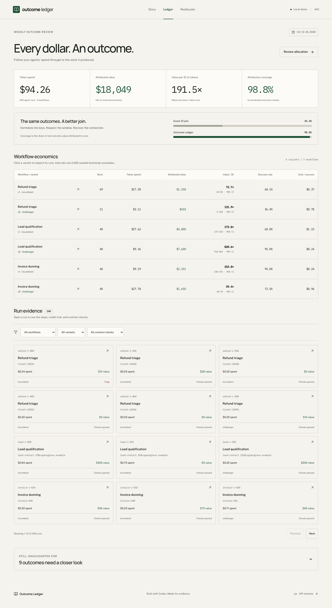

# Outcome Ledger

Join AI agent spend to the business outcomes it produced, then move budget only when the evidence is real.

An independent, open-source reference application for the loop **allocate → work → outcome → attribute → learn → reallocate**. Built with Codex, verified by Claude Code.



[Animated story](docs/story.png) · [Reallocation and replay](docs/reallocate.png) · [Run evidence](docs/run-detail.png) · [Mobile view](docs/ledger-mobile.png)

## Why this exists

Teams operating AI workflows can measure token cost on every call. The value arrives later in CRM, billing, and helpdesk systems, under different identifiers. An operations lead needs to connect those outcomes to the work, then decide which workflow and variant should receive the next dollar.

This project explores accountable agent operations: contracts define success, budgets, permitted tools, and required approvals; an auditable ledger links costs to results; a statistical gate decides whether a challenger deserves promotion. A budget guard alone cannot answer what the spend produced. Governance checks belong alongside the outcome evidence.

The demo follows **Refund triage**, **Lead qualification**, and **Invoice dunning** for October 12–18, 2026. It includes 240 runs, two variants per workflow, 195 events, delayed outcomes, reversals, unmatched records, and contract violations. All people, organizations, model aliases, and operational records are fictional. No external credentials are needed.

## Run locally

Requires Python 3.12, [uv](https://docs.astral.sh/uv/), Node.js 22+, and pnpm 10.12.1. The package-manager version is pinned in both manifests; Corepack can supply it if available. Dependencies are fetched during installation; the app itself makes no external requests. Fonts are bundled locally.

```sh
make dev
```

This installs the locked dependencies, starts FastAPI on **127.0.0.1:8000**, and starts Vite on **127.0.0.1:5173**. Open `http://127.0.0.1:5173/story`. If 8000 is occupied, use `make dev PORT=8017`; the Vite proxy follows that port. Stop both servers with Ctrl+C.

Production:

```sh
make install
make build
make serve PORT=8017
# Open http://127.0.0.1:8017 — redirects to /story
```

FastAPI serves the compiled SPA at `/story`, `/ledger`, and `/reallocate`. Other routes return 404. The only configuration in `.env.example` is optional `PORT`; pass it to Make or export it in your shell. There is no required `.env` file, API key, or live integration.

All managed caches live under `.cache/`, the Python environment under `.venv/`, and frontend dependencies under `web/node_modules/`. SQLite is initialized at `.cache/ledger.sqlite` on first API startup and retained across restarts. To regenerate the demo after a seed change, stop the server and remove that file, then restart.

## What to explore

- **Story** (`/story`): six scrolling sections explain the missing value connection, show the source keys, animate the before/after loop, compare the feature with a budget guard, demonstrate the gate, and display measured impact. Manual Before/After controls are available; reduced-motion mode immediately presents the completed visuals.
- **Ledger** (`/ledger`): spend, net attributed value, value per token dollar, and coverage; workflow/variant economics with 90% intervals; workflow, variant, and governance filters; paginated runs; a keyboard-accessible evidence drawer with steps, tokens, approvals, and credit explanations. The unmatched panel retains every unresolved event and reason.
- **Reallocate** (`/reallocate`): three gate decisions, interval bars around zero, a constrained budget proposal, and replayed value at unchanged spend. This is an inspectable proposal; it does not mutate budgets in an external system.

## Attribution and accounting

`OutcomeSource.fetch(since, until)` returns typed events for a half-open time range. Three mock adapters stand in for CRM, billing, and helpdesk. Their outputs are loaded into SQLite, then the pure attribution engine operates on Pydantic objects.

1. Normalize helpdesk `HS-10293` to `ticket:10293`, billing `INV-2026-00417` to `invoice:417`, and CRM `Dana.Lee+promo@Example.com` to `lead:dana.lee@example.com`. Agent-side identifiers are normalized too. CRM case folding and plus-tag removal are explicit demo policies; dots remain significant.
2. Match the contract’s entity type and success event. Both ends of the contract’s attribution window are inclusive, and a result cannot precede its run. All timestamps must carry a timezone.
3. Split a success equally across every eligible run touching that entity. Sum step costs from the model price table; costs are computed fields, never manually assigned.
4. A negative event reverses prior credit for its entity, only from the original recipients still inside their windows. It never credits a later run negatively, and repeated reversals cannot push a balance below zero. A later success may earn new credit. Expired reversals remain unmatched and change neither value nor coverage.
5. Retain `no_run`, `outside_window`, and `unknown_key_format` records. Ignore non-contract event types. Deduplicate events by ID and process in timestamp/ID order.

**Coverage** is net credited value divided by all countable success value minus eligible reversals. Unmatched successes remain in the denominator, including malformed keys. No denominator means coverage is zero. Each credit carries its source key, canonical key, elapsed days, attribution window, and split or reversal explanation.

`naive_join(runs, events)` is the exact-string-match baseline. The displayed baseline only joins successes on exact IDs, while using the same contract windows, reversal valuation, and denominator as the normalized view. Applying a common reversal policy prevents a reversed result from falsely inflating the baseline.

A successful run is one with positive net credit after reversals. Success rate is successful runs / all runs; cost per success is total spend / successful runs (null when there are none). It describes credited runs, not distinct business entities.

## Promotion gate and allocation

The bootstrap uses `random.Random(42)` and **2,000 independent resamples** of run-level `(spend, net value)` pairs. Each sample recomputes total value / total spend. The 5th and 95th percentiles form a 90% interval. Difference intervals independently resample challenger and incumbent.

- **PROMOTE**: at least 30 challenger runs, and the difference interval’s lower bound is positive.
- **ROLLBACK**: enough runs, and the upper bound is negative.
- **HOLD**: otherwise; retain the incumbent. The extra-run estimate scales interval half-width as `1/√n`, holding observed effect and variance fixed. It also satisfies the minimum-sample requirement. Near-zero effects request another 30-run batch. This estimate is not a guarantee or a sequential-testing correction.

Allocation weights use the selected variant’s **lower confidence bound** on value per dollar, floored at zero. A constrained proportional solver enforces **10% minimum / 60% maximum** workflow shares. With no positive signal, shares are equal. The proposed total equals last week’s token spend exactly (displayed dollars are rounded).

Replay divides each workflow’s proposed budget by its selected variant’s observed cost per run, then multiplies by that variant’s value per run. Fractional runs express a continuous-budget estimate. Both before and after spend are returned explicitly.

## Measured results — seed data only

These values are computed by `/api/impact`, not marketing claims or production measurements.

| Measure | Before | After |
| --- | ---: | ---: |
| Attribution coverage | 35.4% exact-ID | 98.8% normalized |
| Net credited value | $6,477 exact-ID | $18,049 normalized |
| Token spend in replay | $94.26 | $94.26 |
| Value per $1 of tokens | 191.5× observed | 575.7× replayed |
| Total value in replay | $18,049 | $54,269 projected |
| Governance flags | — | 10 across 10 runs |

The flags comprise **5 missing approvals**, **3 budget overruns**, and **2 disallowed-tool calls**. Nine outcomes remain unmatched, with all three reasons represented.

| Workflow | Challenger evidence | Decision |
| --- | --- | --- |
| Refund triage | 11 runs; about 1.8× the incumbent’s point estimate; interval crosses zero; approximately 102 additional runs estimated | HOLD |
| Lead qualification | 40 runs; the entire difference interval is positive | PROMOTE |
| Invoice dunning | 40 runs; the entire difference interval is negative | ROLLBACK |

Next-week shares: **10% refund triage**, **60% lead qualification**, **30% invoice dunning**. Governance flags are surfaced for review; they are not silently treated as causal or statistical evidence in the gate.

## Tests and commands

The current suite has **85 backend tests and 5 frontend tests**. Core tests were written and run before the corresponding implementations. The suite covers normalization, window edges, splits, reversals, accounting bounds, pricing, bootstrap determinism, approval timing, all gate verdicts, allocation constraints, seed invariants, SQLite round trips, and API behavior. Frontend tests cover number rendering, gate copy, the full story, failed-fetch retry, filters, and the evidence drawer.

```sh
make test
# Equivalent:
uv run pytest
uv run ruff check
pnpm --dir web test

make build
# Equivalent:
pnpm --dir web build

uv run python -m outcome_ledger report --json
```

The CLI emits the same summary as the API. Browser verification covers 320, 375, 414, 768, 1280, and 1920 pixel widths, filter-to-drawer interaction, Escape dismissal, and diagram controls. Captured screenshots are in `docs/`.

## API

| Route | Result |
| --- | --- |
| `GET /api/summary?week=2026-10-12` | Totals, both coverage values, workflow and variant metrics |
| `GET /api/runs?workflow=&variant=&flag=` | Filtered runs; empty parameters mean all |
| `GET /api/runs/{id}` | Steps, contract, credits, outcomes, approvals, flags |
| `GET /api/unmatched` | Events and their unmatched reasons |
| `GET /api/gate` | Three promotion decisions with intervals and reasons |
| `GET /api/plan` | Allocations and before/after replay |
| `GET /api/impact` | Numbers and gates used by the story |
| `GET /openapi.json` | Machine-readable API schema; no external documentation CDN |

Only the seeded week is supported. Unsupported weeks return 404; malformed dates or unknown filter enum values return 422. Unknown runs and paths return 404.

## Stack and extension points

- **Backend:** Python 3.12, FastAPI, Pydantic v2, SQLite, uvicorn, uv, pytest, ruff. Bootstrap and statistical operations use only Python’s standard library.
- **Frontend:** React 18, strict TypeScript, Vite, Tailwind 3, framer-motion, lucide-react, pnpm, Vitest, Testing Library. The paper/ink/green design tokens live in `web/src/index.css` and `tokens.css`, mapped by `web/tailwind.config.ts`.
- **Sources:** implement `OutcomeSource` in `outcome_ledger/sources.py`; supply real normalization policies, event validation, and ingestion scheduling at this boundary.
- **Pricing:** replace the fictional `reasoner-mini` ($1 input / $4 output) and `reasoner-pro` ($3 input / $12 output) rates per million tokens in `pricing.py` with your model/provider table. This demo compares illustrative costs, not current provider prices.
- **Storage:** `store.py` persists `contracts`, `runs`, `steps`, `outcomes`, and `credits`. Substitute warehouse-backed reads for SQLite while keeping the pure engine unchanged. Credits are persisted for audit and recomputed by the read model from source records.

## Limitations

This is a deterministic local demo, with no authentication, tenant isolation, ingestion API, external integrations, or live budget execution. The forecast assumes constant unit economics, divisible work, and sufficient demand; it does not model capacity or outcome saturation. Outcome windows are observed as of October 19; some runs have not exhausted their windows, so real deployments need a maturation policy before promotion. Equal-split attribution is intentionally simple; correlated runs and repeated entities violate the bootstrap’s independence assumption. Attribution and bootstrap intervals are **not causal inference**. The gate ignores the business risk of a flagged run unless an operator adds that policy.

The seeded controls are reproducible examples, not evidence of real-world returns. Replace the fictional identity, value, pricing, and governance policies before using real data.

Built with Codex, verified by Claude Code (tests, production build, a backend review and a browser check of all three pages).
